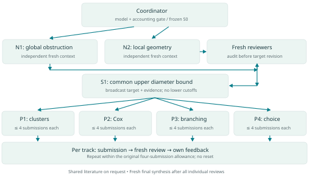

# Reciprocal-simplex experiment — GPT-6-Astra

## Main paper and reading order

**[Main Astra draft — paper PDF](00_main_draft/reciprocal_simplex.pdf)** · **[Editable LaTeX](00_main_draft/reciprocal_simplex.tex)**

The 23-page manuscript of 21 October 2026 is the current main draft for this Astra version. It follows the approach-4 proof with a reproducible simulation study. The source and figures are in `00_main_draft/`, the first folder in this directory. [Overleaf instructions](../../03_documentation/overleaf.md).

1. [Paper and build](00_main_draft/README.md)
2. [Simulation, full results and saved-data download](01_simulation/README.md)
3. [Writing, independent reading, decisions and token records](02_writing_record/README.md)
4. [Original experiment report](report/astra6_experiment_report.pdf) and the research evidence below
5. [Presentation](../../agentic_ai_math_talk.pdf), [tutorial](../../02_tutorial/README.md), [agent architecture](../../03_documentation/architecture.md) and [reasoning records](../../03_documentation/reasoning.md)

This folder publishes the completed 20 October 2026 experiment, run
`20261020T164437Z_astra6`, separately from the
[earlier-model experiment](../reciprocal-simplex-agentic-research/README.md).
Every registered research role used verified `gpt-6-astra` with `xhigh` effort.

**Read the [16-page experiment report](report/astra6_experiment_report.pdf)**
for the architecture, high-level mathematical development, all investigators
and reviews, the resulting process, and token/runtime accounting.
Its [editable text](report/report.md), [content data](report/report.json) and
[PDF build script](report/build_report.py) are included.

## Result

The unrestricted exact statement **S0 is false at every positive intensity**.
After independent reviews of general obstructions, the coordinator adopted
**S1**, requiring the exact full reciprocal distance, triangle-area and
tetrahedron-volume densities on nondegenerate configurations of diameter below
an arbitrary prescribed bound M. All nondegenerate shapes remain allowed,
with no lower cutoff or finite-fourth-moment assumption.

The investigator-choice track **P4 proved unchanged S1 on submission 4 of 4**,
accepted by a fresh individual reviewer and the final independent synthesis.
The construction chooses with a fair coin between a separated-sphere process
and a separated-cluster correction process. Its intensity is arbitrary and
prescribed; it is deliberately non-ergodic.

These are the conclusions of the archived informal mathematical reviews, not
formal machine verification or a novelty certificate.

- [Exact S1 statement](archive/statements/S1.md)
- [Winning construction, P4 v04](archive/tracks/proof_4/submissions/v04.md)
- [Independent review of the construction](archive/reviews/proof_4_v04/review.md)
- [Final synthesis: 45 findings](archive/review_report.md)
- [All 16 submissions and individual reviews](SUBMISSIONS.md)
- [Statement history](archive/target_history.md) and [current outcome ledger](archive/statements/ledger_v02.json)
- [Decision log](archive/decisions.md) and [attempt ledger](archive/attempt_ledger.json)

| Approach | Submissions | Final reviewed outcome |
|---|---:|---|
| P1: Poisson clusters | 4/4 | Valid partial theorems; exact S1 not attained |
| P2: Cox processes | 1/4 | Entire Cox class excluded; owner approved early closure, three unused |
| P3: Hawkes/branching | 4/4 | Valid partial theorems; exact S1 not attained |
| P4: Investigator choice | 4/4 | Exact unchanged S1 accepted |

The proposed small-intensity S2 amendment was never approved or adopted.
No attempt count reset. The initial obstruction phase used two independent
investigators, with a fresh review before any obstruction-driven revision.

## Runtime and usage

Research ran from **16:46:33.978 to 19:46:53.601 UTC** on 20 October 2026:
**3 hours and 20 seconds**, rounded. There are **25 registered sessions and
37 turns**, including preflight; 36 delegated turns have completion boundaries.
The coordinator's final-response tail is outside the frozen snapshot.

| Measure | Value | Interpretation |
|---|---:|---|
| Input tokens | 98,161,559 | Raw arithmetic sum of measured session counters |
| Cached input | 94,032,384 | Included in input |
| Output tokens | 916,615 | Includes 343,806 reasoning tokens |
| Total tokens | 99,078,174 | Input + output; parent/child overlap is unverified |
| Standard-price scenario | $181.15 | API-equivalent estimate assuming disjoint session counts |
| Actual charge | NR | Not available; no invoice or subscription charge inferred |

The user recalled that Fast was not enabled. The recorded telemetry does not
verify the billed tier. Standard pricing is the working estimate; the alternative
Fast/priority scenario is $362.31. See the [accounting guide](accounting/README.md),
[per-agent CSV](accounting/agents.csv) and [per-turn CSV](accounting/turns.csv).
Subsequent conversation, source lookup and this documentation work are excluded
from the original experiment totals.

## Architecture and evidence



The [frozen workflow](archive/inputs/workflow.json),
[launch prompt](archive/inputs/START.md),
[coordinator instructions](archive/inputs/instructions/coordinator.md),
[role instructions](archive/inputs/instructions/),
[model configuration](archive/inputs/.codex/) and
[dispatch packets](archive/packets/) document the protocol. Only the coordinator
dispatched. Independent roles received fresh contexts and explicit file packets;
new construction ideas were not transferred between tracks. Maximum concurrent
delegated agents: three. The shared literature role answered one precise source
question. The configured coding role was not used.

This is a curated public archive. It preserves explicit proofs, high-level
reasoning summaries and extensive reviews, **not private chain-of-thought**.
Machine-specific paths and session identifiers were sanitised. Copied third-party
papers, raw runtime conversations, private work notes and personal skill bodies
are excluded. Consequently some historical source references intentionally have
no corresponding public file. The protocol's independence rules were cooperation
rules, not operating-system isolation.

[Export provenance](provenance/export_manifest.json) maps original hashes to
public-copy hashes. Embedded historical hashes refer to the original files;
the [release manifest](provenance/release_manifest.json) verifies this export.
The [documentation review](provenance/documentation_review/README.md) is separate
from the original mathematical reviews and accounting.

## Rebuild and check

Install Python 3, ReportLab and DejaVu Sans fonts. From this directory:

```sh
python report/build_report.py
python verify_release.py
```

If the fonts are outside the script's standard search paths, set
`RESEARCH_REPORT_FONT_DIR` to their directory. Rebuilding the PDF changes its
metadata and thus may change its byte hash; verify the released files before
rebuilding. No research or model calls are made by either script.

The prior and present experiments differ in protocol and target history. They
are case studies, not a controlled benchmark of model performance.
